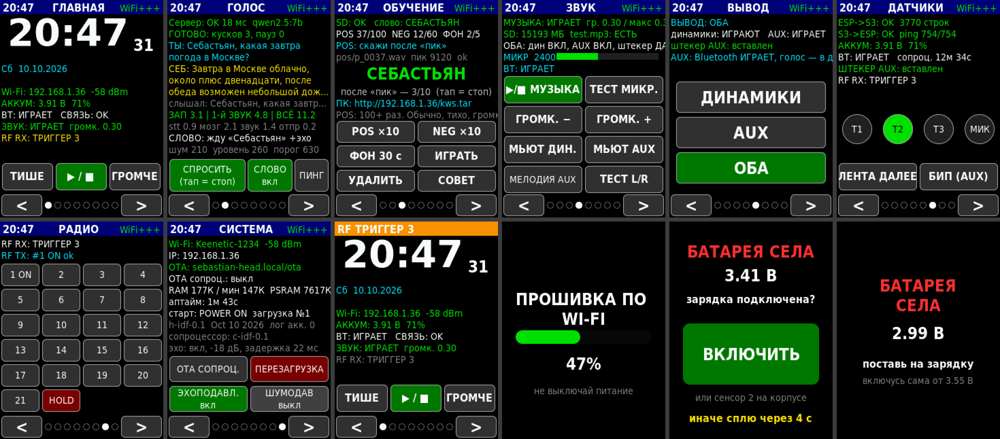

# firmware/ — прошивки «Себастьяна» на ESP-IDF

Обе платы на чистом **ESP-IDF v5.5.5** (FreeRTOS, без Arduino). ТЗ: [`../TZ_ESP-IDF_Sebastian.md`](../TZ_ESP-IDF_Sebastian.md).
Версии: голова **h-idf-0.1**, со-процессор **c-idf-0.1** (история — `common/include/seb_version.h`).

> ⚠️ **Всё проверено только сборкой, тестами на ПК и симулятором экрана — на железе ещё НЕ запускалось.**
> Поэтому сначала по чек-листу ниже, по одной плате.



## Что где

| Папка | Что |
|---|---|
| `bin/` | **готовые прошивки** — собирать ничего не надо |
| `head/` | голова (ESP32-S3): `main/` код, `components/` минимум ESP-SR (эхоподавление), `sim/` симулятор экрана на ПК |
| `coproc/` | со-процессор (ESP32) |
| `common/` | общее: протокол UART, OTA с откатом, HTTP-клиент, DSP, радио 433; `test/` — тесты на ПК |
| `tools/` | `flash_cable.bat` (первый раз), `ota_head.bat` / `ota_coproc.bat` (по Wi-Fi), `ota_upload.py`, `build_all.sh` |

Файлы в `bin/`:

| Файл | Куда | Как |
|---|---|---|
| `sebastian_head_full.bin` | голова | **кабель**, с адреса 0x0 (первый раз) |
| `sebastian_head.bin` | голова | **Wi-Fi** (OTA) |
| `sebastian_coproc_full.bin` | со-процессор | **кабель**, с адреса 0x0 (первый раз) |
| `sebastian_coproc.bin` | со-процессор | **Wi-Fi** (OTA) |
| `test_rollback_head.bin` | голова | Wi-Fi — нарочно «битая» (без Wi-Fi), проверка автоотката |

## Как залить

### Порядок: сначала голова, со-процессор пока остаётся на Arduino
Новая голова понимает старый Arduino-со-процессор (протокол совместим). Так меньше риска.

### 1. Голова — первый раз ПО КАБЕЛЮ (порт UART, COM4)
Флеш у IDF размечен иначе, чем у Arduino, — по Wi-Fi с Arduino на IDF не перейти. Только кабелем, один раз.

1. Скачай репозиторий (ветка с прошивкой) — нужны папки `firmware/bin` и `firmware/tools`.
2. Закрой монитор порта в VS Code (он держит COM-порт).
3. Двойной щелчок `firmware\tools\flash_cable.bat` → `1` (голова) → `COM4`.
   Скрипт **стирает флеш целиком** и пишет `sebastian_head_full.bin`. Использует esptool из PlatformIO.
   - Нет PlatformIO/питона? Вариант без установки: Chrome/Edge → https://espressif.github.io/esptool-js/ →
     Connect → **Erase Flash** → файл `sebastian_head_full.bin`, адрес `0x0` → Program.
4. Плата перезагрузится. Wi-Fi ещё не настроен → на экране «Wi-Fi: настройка — точка «Sebastian-setup»».

### 2. Настройка Wi-Fi (один раз, с телефона)
1. Телефон → Wi-Fi **Sebastian-setup**, пароль **sebastian123**.
2. Браузер → **http://192.168.4.1/setup**.
3. Впиши: имя и пароль домашнего Wi-Fi, **новый пароль OTA** (придумай), сервер `192.168.1.201` порт `9010` → Сохранить.
4. Голова перезагрузится и подключится. IP — на экране ГЛАВНАЯ и СИСТЕМА, имя — `sebastian-head.local`.

Пароли хранятся только в плате (NVS), в git не попадают. Поменять потом: `http://<IP головы>/setup`.

### 3. Голова — дальше только ПО WI-FI
Двойной щелчок `firmware\tools\ota_head.bat` → адрес (Enter = `sebastian-head.local`) → пароль OTA.
Или одной командой (curl есть в Windows 10+):
```
curl -u ota:ПАРОЛЬ --data-binary @sebastian_head.bin http://sebastian-head.local/ota
```
Windows может спросить разрешение брандмауэра — **Разрешить**.

### 4. Со-процессор — первый раз ПО КАБЕЛЮ (порт CH340)
`flash_cable.bat` → `2` → COM-порт CH340. После старта он сам попросит у головы настройки Wi-Fi (для своей OTA).

### 5. Со-процессор — дальше ПО WI-FI
Экран головы СИСТЕМА → **OTA СОПРОЦ.** → лента фиолетовая, на экране «OTA сопроц.: ЖДУ 192.168.x.x» →
`ota_coproc.bat` → этот IP → пароль OTA. 5 минут на заливку, потом он сам вернётся в обычный режим.

### Откат на Arduino
Только кабелем: старые проекты в `ESP32_Sebostian/` — Upload по проводу как раньше (PlatformIO перезапишет разметку).

## Как работает защита OTA (почему колонку не придётся разбирать)

- Два слота прошивки. Новая после OTA стартует «на проверке» и становится рабочей, только когда поднялись
  **Wi-Fi + веб-сервер и прошло 30 с без падений**. Не поднялись за 2 минуты или упала — **сама откатывается на прошлую**.
- **Безопасный режим**: 3 аварийных перезагрузки подряд в первую минуту → стартуют только Wi-Fi + OTA
  (экран, звук, голос — нет). Залей исправленную прошивку по Wi-Fi. Снимается кнопкой ПЕРЕЗАГРУЗКА/после OTA/выключением питания.
- Со-процессор: новая прошивка после OTA сначала поднимает Wi-Fi + /ota (проверка), потом перезагружается в обычный режим с BT.
  3 падения подряд → режим OTA.

## Чек-лист проверки на стенде

**Голова (со старым Arduino-со-процессором):**
1. После кабеля: экран живой, надписи **по-русски**, часы идут после настройки Wi-Fi (NTP, МСК).
2. Тач: нажимаются кнопки **по всему экрану** — углы, < >, мелкие кнопки на РАДИО. Промахи — напиши, куда попадает.
3. ДАТЧИКИ: связь в обе стороны OK, батарея, сенсоры T1–T3/МИК загораются. РАДИО: коды и HOLD уходят.
4. ЗВУК: ▶/■ МУЗЫКА — `test.mp3` чисто на 0.30; ГРОМЧЕ до упора — **не хрипит** (потолок 0.35); ТЕСТ L/R — слева 3, справа 2 стука; ТЕСТ МИКР — слышно себя; щелчков при старте нет.
5. ГОЛОС: ПИНГ → «Сервер: OK»; СПРОСИТЬ → ответ голосом; кнопка мика на со-процессоре (держи и говори).
6. «Себастьян, который час?» — через ~20 с после старта; **и во время музыки** (эхоподавление).
7. OTA 3 раза подряд по Wi-Fi (`ota_head.bat`) — всё живо. Потом `test_rollback_head.bin` по Wi-Fi:
   экран «ТЕСТ ОТКАТА», через ~2 мин плата **сама вернётся** на нормальную прошивку.

**Со-процессор (после кабеля):**
1. Писк в AUX при старте, радуга на ленте. На голове СИСТЕМА → «сопроцессор: c-idf-0.1».
2. Телефон видит **Sebastian**, музыка в AUX без заиканий 10 мин.
3. Сенсоры, кнопка мика, LED NEXT, БИП, МЕЛОДИЯ AUX, все радиокоды + HOLD на реальных устройствах.
4. OTA со-процессора по кнопке с головы — 2–3 раза.
5. Батарея (если есть аккум): значение похоже на мультиметр (поправка — `BAT_CAL_MV` в `coproc/main/board.h`).

Что-то не так — пришли: фото экрана, `http://<IP головы>/log` и `http://<IP головы>/status` (или `/screenshot`).

## Отладка по Wi-Fi (кабель не нужен)

| Адрес | Что |
|---|---|
| `http://<голова>/status` | JSON: версия, слот, память, задачи (CPU%, стек), звук, эхоподавление, голос, со-процессор |
| `http://<голова>/log` | последние 32 КБ лога (у со-процессора `/log` — в режиме OTA) |
| `http://<голова>/screenshot` | снимок экрана (BMP) |
| `http://<голова>/coredump` | дамп последнего падения → `idf.py coredump-info -c coredump.bin` (с той же сборкой) |
| `http://<голова>/setup` | Wi-Fi, пароль OTA, сервер, потолок громкости, подстройка AEC |
| `http://<голова>/kws.tar`, `/bat.tar`, `/bat_clear?yes=1` | сэмплы TRAIN, лог батареи |

## Решения, принятые по вопросам из ТЗ §10 (можно поменять)

- **Частота вывода — 48 кГц.** Голос сервера (24 кГц) ×2 ровно, reference для AEC (16 кГц) ÷3 ровно; MP3 44.1 кГц пересчитывается ресемплером Эрмита.
- **Себастьян говорит → музыка приглушается (дакинг ×0.25)**, AVRCP-пауза телефона не делалась (BT пока идёт только в AUX).
- **Слово-активатор** — как было: детектор речи + Whisper (/stt). Готового «Себастьян» в WakeNet нет; своё — фаза 8.
- **Экраны** — раскладка как в v21, надписи по-русски.
- **Потолок громкости динамиков 0.35** — меняется на `/setup`. ГРОМЧЕ выше потолка не поднимает.
- **Режим вывода AUX**: шины звука раздельные (74HC4053 нет), голова в AUX звучать не может. Поэтому в режиме AUX
  динамики молчат, но **голос Себастьяна и звуки головы всё равно идут в динамики**, иначе его не слышно.
- Wi-Fi и пароль OTA — не в прошивке, а в NVS (страница `/setup`): готовые `.bin` можно хранить в git.

## Что НЕ сделано (опциональные фазы)

- **Фаза 7** — Bluetooth в динамики через отдельный UART (GPIO23 → GPIO1).
- **Фаза 8** — своё слово-активатор (microWakeWord): нужны сэмплы TRAIN и обучение.
- ESP-SR VAD/NS-модели не используются: свой детектор речи (как в Arduino) + WebRTC-шумодав (выключен по умолчанию — кнопка ШУМОДАВ на СИСТЕМА).

## Сборка самому (не обязательно)

ESP-IDF **v5.5.5** (Windows: ESP-IDF Installer / VS Code Extension; путь проекта **без пробелов и кириллицы**).
```
cd firmware/head   && idf.py build      # голова
cd firmware/coproc && idf.py build      # со-процессор
firmware/tools/build_all.sh             # обе + тестовая + склейка в bin/ (Linux/WSL)
```
Зависимости (LVGL 9.2.2, mdns, libhelix-mp3) тянутся **с GitHub** по тегам из `main/idf_component.yml` (нужен git).
Эхоподавление — `head/components/sr_lite` (минимум из ESP-SR, лежит в репо).

Тесты на ПК: `firmware/common/test/run_tests.sh` (22 теста: протокол, base64/JSON, WAV, ресемплер, лимитер, VAD, радио 433, HTTP-клиент против макета сервера).
Симулятор экрана: `firmware/head/sim/run.sh` → картинки всех страниц в `sim/out/`.
